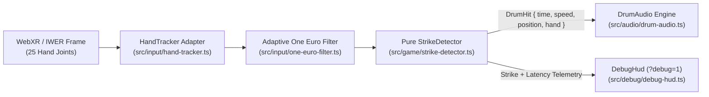

# Phase 1 Implementation Plan (`docs/PHASE1_PLAN.md`) — Hands-Only Strike Detection & Drum Sound (M1)

> **Status:** Draft Plan for Review (No Phase 1 code or dependency changes included in this PR).

---

## 1. Scope & Architecture Overview

Phase 1 (Milestone **M1**) transforms the M0 "Hello XR" baseline into an interactive, hands-only talking drum prototype where striking the drumhead with the player's tracked hand produces an immediate, velocity-sensitive, spatially positioned drum sound with live diagnostic telemetry.



---

## 2. Subsystem Design

### 2.1 `HandTracker` Adapter (`src/input/hand-tracker.ts` & `src/input/one-euro-filter.ts`)

- **Joint Pose Acquisition:**
  - Subscribes to the live WebXR frame via `world.onXRFrame((frame, delta, elapsedTime) => ...)` (and reads `world.player.indexTipSpaces` / `XRInputSource.hand` joint spaces).
  - Samples the primary striking joint (`index-finger-tip` and/or `middle-finger-tip` / `palm` strike point, configurable in `src/app/config.ts`) against the active `XRReferenceSpace` (`world.renderer.xr.getReferenceSpace()`).
- **Confidence & Emulation Gating:**
  - Checks `inputSource.hand != null` and `frame.getJointPose(jointSpace, refSpace)`.
  - Gates out missing poses (`jointPose == null` or `Number.isNaN(jointPose.transform.position.x)`).
  - Distinguishes hardware-tracked poses (`jointPose.emulatedPosition === false`) from emulator/interpolated poses (`jointPose.emulatedPosition === true`). Controlled by `APP_CONFIG.handTracking.allowEmulatedPoses` (default `true` so IWER and desktop emulation work out of the box, with a HUD indicator showing `TRACKED` vs `EMULATED`).
- **Adaptive Jitter Filtering (`OneEuroFilter3D`):**
  - Pure, allocation-free 3D One Euro low-pass filter (`src/input/one-euro-filter.ts`) applied per hand to smooth optical hand-tracking jitter at rest without adding lag during fast drum strikes:
    $$\alpha(\tau, \Delta t) = \frac{1}{1 + \tau / \Delta t}, \quad f_c = f_{c,\min} + \beta \cdot \|\dot{\mathbf{x}}_{\text{filtered}}\|$$
  - Configurable in `src/app/config.ts` (`minCutoffHz: 1.5`, `beta: 0.04`, `dCutoffHz: 1.0`).
  - Resets filter history cleanly after any tracking dropout exceeding `maxGapMs: 100`.

### 2.2 `StrikeDetector` Pure Function (`src/game/strike-detector.ts`)

- **Pure Functional Contract:**
  - `detectStrike(prevSample, currSample, handState, config): { hit: DrumHit | null; nextState: HandStrikeState }`
  - Zero Three.js scene graph or WebXR globals required inside `detectStrike` so it is 100% unit-testable with plain coordinates.
- **Coordinate Space & Swept Segment Test:**
  - The ECS system (`StrikeSystem`) transforms the filtered world-space hand strike point into **drum-local coordinates** using the drum entity's inverse world matrix (`drumObject.worldToLocal(localPos)`), where the struck drumhead plane lies at $y = +L/2$ (or the front/top struck head normal in drum-local space) with radius $R_{\text{skin}} = \text{headRadiusMeters}$ (`0.11 m`).
  - **Swept Segment vs. Skin Plane:**
    1. Checks whether the signed distance to the skin plane crossed from positive (outside the drumhead: $d_{t-1} > 0$) to non-positive (at or inside the drumhead: $d_t \le 0$) during $\Delta t = t - t_{t-1}$.
    2. Computes the exact interpolation fraction $u = \frac{d_{t-1}}{d_{t-1} - d_t} \in [0, 1]$ and intersection point $\mathbf{p}_{\text{hit}} = \mathbf{p}_{t-1} + u(\mathbf{p}_t - \mathbf{p}_{t-1})$ on the skin plane.
    3. **Hit Radius Gate:** Verifies radial distance from drumhead center $r = \sqrt{p_{\text{hit},x}^2 + p_{\text{hit},z}^2} \le R_{\text{skin}} + r_{\text{margin}}$, where `skinRadiusMarginMeters = 0.01` (`0.11 m + 0.01 m = 0.12 m`).
    4. **Minimum Inward/Downward Speed Gate:** Computes normal approach speed $v_{\text{normal}} = \frac{d_{t-1} - d_t}{\Delta t}$ and requires $v_{\text{normal}} \ge \text{minStrikeSpeedMetersPerSec}$ (starting at **`0.30 m/s`**).
    5. **Per-Hand Debounce & Re-Arm Hysteresis:** Enforces `debounceMs: 90` per hand (`tHit - lastHitTimeMs >= 90`) and requires the hand to rise back above `rearmHeightMeters: 0.008` (`8 mm`) before a subsequent strike on the same hand can fire.
- **Emitted Payload (`DrumHit`):**
  ```ts
  export interface DrumHit {
    readonly timeMs: number;
    readonly speedMetersPerSec: number;
    readonly localPosition: { readonly x: number; readonly y: number; readonly z: number };
    readonly radialNormalized: number; // 0 = center, 1 = rim
    readonly hand: 'left' | 'right';
  }
  ```
- **Centralised Tunables in `src/app/config.ts`:**
  - `strike.minDownwardSpeedMetersPerSec`: `0.30`
  - `strike.debounceMs`: `90`
  - `strike.hitRadiusMarginMeters`: `0.01` (effective radius `0.12 m` with `headRadiusMeters: 0.11`)
  - `strike.rearmDistanceMeters`: `0.008`
  - `strike.primaryHand`: `'right'` (`'left' | 'right'`, with `allowSecondaryHand: true` configurable)

### 2.3 Drum Sound Engine (`src/audio/drum-audio.ts`) & Original Sample Strategy

- **Single `AudioContext` Lifecycle:**
  - Instantiates one shared `AudioContext` (`{ latencyHint: 'interactive' }`).
  - Hooks the first user gesture (`#enter-vr-button` click, spatial `#xr-button` click, or `pointerdown`/`selectstart`) to call `await audioCtx.resume()`.
- **Pre-Decoded Sample Buffer & Original Audio Sourcing (Zero Third-Party Audio):**
  - **Recommended M1 Strategy (Procedural `OfflineAudioContext` Buffer + Optional Local `.wav` Export):**
    - At audio engine initialisation, an `OfflineAudioContext` pre-renders a `0.65 s` mono `AudioBuffer` (at `48 kHz`) modeling a Yoruba _gángan_ strike: a pitched membrane fundamental (`145 Hz` with initial transient pitch-drop envelope), a second overtone mode (`1.58x`), and a short woody shell body impulse.
    - Because it is rendered once into a static `AudioBuffer` at startup, runtime playback uses standard `AudioBufferSourceNode` buffer playback — identical to playing a decoded `.wav`/`.ogg` file.
    - Additionally, `drum-audio.ts` supports `decodeAudioData` for a local asset path (`public/audio/gangan-open-placeholder.wav`) so Fredrick can drop in his own recorded talking drum sample in Phase 1/2 without changing playback code.
    - Recorded in `docs/ASSET_REGISTER.md` as an original MIT-licensed procedural placeholder (`Fredrick Da-Costa & Antigravity`), explicitly marked `"Placeholder — to be replaced by Fredrick's original studio recording"`. Zero third-party audio or external network fetches.
- **Velocity-to-Gain Curve & Spatial Panner:**
  - Maps `speedMetersPerSec` $\in [0.30, 3.0]\text{ m/s}$ to normalized velocity $v \in [0, 1]$ with a natural perceptual curve:
    $$g(v) = g_{\min} + (1 - g_{\min}) \cdot v^{\gamma}, \quad g_{\min} = 0.15,\ \gamma = 0.75$$
  - Routes `AudioBufferSourceNode -> GainNode -> PannerNode -> audioCtx.destination`.
  - `PannerNode` is configured at the drumhead's 3D world position (`panningModel: 'HRTF'` with fallback to `'equalpower'`, `distanceModel: 'inverse'`, `refDistance: 0.5`).

### 2.4 Latency Probe in `DebugHud` (`src/debug/debug-hud.ts`)

- When `?debug=1` is active, `DebugHud` displays live Phase 1 diagnostics updated without per-frame DOM layout thrashing:
  - **Tracking state:** `hand: R (tracked|emulated) | dist: +0.042m`
  - **Last strike:** `hit: #3 (R) | v: 0.84 m/s | r: 0.04m`
  - **Latency probe:**
    - ` pipelineLatencyMs = performance.now() - hit.frameTimestampMs` (time from XR frame callback entry through filter + `StrikeDetector` to `AudioBufferSourceNode.start(0)` invocation, target `< 2.0 ms`).
    - `estimatedOutputLatencyMs = pipelineLatencyMs + ((audioCtx.baseLatency ?? 0) + (audioCtx.outputLatency ?? 0)) * 1000` (reports both software dispatch latency and Web Audio hardware buffer latency).

### 2.5 Hands-Only Ergonomics & Known M0 Layout Follow-Ups

- **Hands-Only Controls:**
  - Right-hand strike enabled first (`primaryHand: 'right'`); left/right hand dominance swappable via `APP_CONFIG.strike.primaryHand` (and URL flag `?hand=left` for quick testing).
  - Every UI control (`Enter VR` / `Exit to Browser`) remains reachable via hands-only input (pinch ray / near poke on the spatial `welcome.uikitml` panel).
- **Known Layout Follow-Ups from M0:**
  1. **Welcome Panel vs. Drum Separation:** Raise `welcome-panel` in `public/scenes/main.iwsdk.scene.json` from `y: 1.55, z: -1.35` to `y: 1.68, z: -1.45` (and scale slightly if needed) so the welcome card sits cleanly above the drum with clear visual separation.
  2. **Drum Cropping & Scale:** Adjust the placeholder talking drum's default placement/scale in `src/app/config.ts` (`distanceAheadMeters: 0.58`, `belowEyeLevelMeters: 0.30`) and `public/scenes/main.iwsdk.scene.json` so the lower edge of the drum is fully inside the default camera frustum and comfortable to strike.
  3. **Seated Eye-Level Verification:** Verify seated eye-level calibration (`PanelSystem`) on physical Quest hardware and clamp calibrated `headWorldPos.y` to a sensible seated range (`[0.85 m, 1.55 m]`).

---

## 3. Testing Strategy & How to Switch IWER v2.0.0 to Hand Tracking

### 3.1 Unit & Fixture Tests (`npm run test:unit`)

- `tests/fixtures/hand-paths.ts`: Deterministic synthetic and recorded 72 Hz / 90 Hz hand trajectories:
  1. `cleanDownwardStrikePath`: crosses skin plane at `0.85 m/s` within radius `0.03 m` $\rightarrow$ emits 1 `DrumHit`.
  2. `slowHoverPath`: crosses skin plane at `0.18 m/s` (`< 0.30 m/s`) $\rightarrow$ emits `null`.
  3. `doubleBounceWithinDebouncePath`: two crossings `40 ms` apart (`< 90 ms`) $\rightarrow$ emits only the first `DrumHit`.
  4. `rimMissOutsideRadiusPath`: crosses plane at `r = 0.14 m` (`> 0.12 m`) $\rightarrow$ emits `null`.
  5. `upwardReturnPath`: moves from inside to outside the plane $\rightarrow$ emits `null`.
- `tests/unit/one-euro-filter.test.ts`: Validates stationary jitter attenuation, high-speed step response lag, and dropout reset.
- `tests/unit/strike-detector.test.ts`: Validates all 5 trajectories, left/right hand independence, and config overrides.

### 3.2 Playwright E2E Tests (`npm run test:e2e`)

- Verifies that a synthetic strike event (or injected WebXR/IWER hand trajectory in `?debug=1` mode) updates the `DebugHud` strike counter and latency probe with zero console errors, zero failed requests, and zero third-party network requests.

### 3.3 What Can and Cannot Be Proven Without a Physical Headset

| Verification Target                                                     | Provable in CI / Desktop IWER? | Requires Physical Meta Quest? |
| ----------------------------------------------------------------------- | ------------------------------ | ----------------------------- |
| Pure `StrikeDetector` math, velocity threshold, radius & 90 ms debounce | **Yes** (Vitest unit tests)    | No                            |
| `OneEuroFilter3D` smoothing & dropout reset                             | **Yes** (Vitest unit tests)    | No                            |
| `AudioContext` resume, buffer synthesis/decode, gain & panner nodes     | **Yes** (Desktop Chrome/IWER)  | No                            |
| Latency probe instrumentation in `?debug=1` HUD                         | **Yes** (Playwright + IWER)    | No                            |
| Real optical hand-tracking confidence dropouts & occlusion behaviour    | **No**                         | **Yes** (Quest cameras)       |
| True motion-to-photon / motion-to-ear acoustic latency (`< 35 ms`)      | **No**                         | **Yes** (Quest audio HAL)     |
| Seated ergonomic comfort & 72/90 FPS thermal stability                  | **No**                         | **Yes** (Quest hardware)      |

### 3.4 Step-by-Step Guide: Switching Immersive Web Emulator (v2.0.0) from Controllers to Hand Tracking

Because Fredrick's M0 check ran in IWER v2.0.0's default controller mode, use these exact steps in desktop Chrome to test **hand-tracking input**:

1. **Open the Page & DevTools Panel:** Navigate to `https://fredrickdacosta.github.io/talking-drum-vr/?xrfps=1&debug=1`, open Chrome DevTools (`F12` or `Ctrl+Shift+I`), and select the **WebXR** (or **Immersive Web Emulator**) tab in DevTools.
2. **Switch Input Mode from Controllers to Hands:**
   - In the emulator header / device toolbar (next to the **Meta Quest 3** device selector), locate the **Input Mode** toggle (it defaults to **Controllers** / gamepad icon).
   - Click the toggle to switch from **Controllers** to **Hands** (hand icon / **Hand Tracking**).
   - _(Note: If you have already clicked **Enter VR**, toggling to **Hands** immediately disconnects the virtual controllers and attaches virtual left/right `XRHand` input sources with 25 articulated joints)._
3. **Enter VR & Drive the Right Hand:**
   - Click **Enter VR** on the page.
   - In the emulator 3D viewport (or on-canvas DevUI gizmo), select the **Right Hand**, hold the translate handle (`Y` vertical axis), and move the right hand downward through the top drumhead (`y ≈ 1.25 m`, `z ≈ -0.50 m`).
   - Verify in the bottom-right `?debug=1` HUD that `hand: R` transitions to active and records the strike speed and latency in milliseconds, with **zero red console errors**.

---

## 4. Investigation: Lazy-Loading Desktop Emulation (`?emulate=1`) & Startup Loading Indicator

### 4.1 Can IWER or a Simulated-Hands Mode Be Lazy-Loaded in Production Behind `?emulate=1`?

#### Findings

1. **Feasibility with IWSDK `1.0.1`:**
   - **High (`100%` compatible).** In `src/index.ts`, `World.create()` checks `navigator.xr` when initialising XR offers and launching sessions.
   - If `getAppFlags()` detects `?emulate=1` **before** `World.create()` is called, `src/index.ts` can execute a dynamic `await import('./platform/desktop-emulator.js')` that instantiates `XRDevice` from `iwer` (`new XRDevice(metaQuest3)`), sets `device.installRuntime()`, and switches `device.primaryInputMode = 'hand'`.
   - Alternatively (or in addition), a lightweight **Simulated Desktop Hands** mode (`?emulate=1`) can drive the drum directly via mouse/trackpad or keyboard (`Space` / click-to-strike at cursor position on the drumhead) even without entering a full WebXR session, OR boot full IWER `XRDevice` with articulated hands so clicking **Enter VR** works in any desktop browser with **zero browser extensions installed**.
2. **Bundle Size Impact (Measured from `node_modules`):**
   - `iwer` (`v2.6.0`, already present in `node_modules/iwer`): `iwer.module.min.js` is **`263,136 B` (`263.1 kB` raw / `~75 kB` gzipped)**.
   - `@iwer/devui` (`v2.6.0`, optional on-screen gizmo UI): `iwer-devui.module.min.js` is **`875,805 B` (`875.8 kB` raw / `~270 kB` gzipped)** because it bundles React 19 and `styled-components`.
   - **Initial-Load Bundle Impact:** **`0 B` (`0.000 MB`)**. Because `import('./platform/desktop-emulator.js')` is a conditional dynamic `import()` gated behind `flags.emulate`, Vite emits it as an async lazy chunk that is **never** added to `<link rel="modulepreload">` or downloaded by normal users. Our `tools/budget-check.mjs` script verifies that initial-load JS remains at `~0.827 MB` gzipped (limit `1.50 MB`).
   - **Total `dist/` Budget Impact:** `+0.26 MB` (`iwer` runtime only) or `+1.14 MB` (`iwer` + `@iwer/devui`), bringing total `dist/` from `3.572 MB` to `~3.83–4.71 MB` (well under the `25.00 MB` limit).
3. **Licences:**
   - `iwer@2.6.0`: **MIT** (Meta Platforms, Inc.)
   - `gl-matrix@3.4.4`: **MIT**
   - `webxr-layers-polyfill@1.1.0`: **MIT**
   - `@iwer/devui@2.6.0`: **MIT** (Meta Platforms, Inc.)
   - All dependencies are permissive MIT and already exist in the lockfile tree.
4. **Risks & Mitigations:**
   - **Risk 1 — Third-party CDN fetches:** By default, `@iwsdk/xr-input` attempts to fetch controller/hand glTF meshes from a CDN if a WebXR session starts without local mesh overrides, which would violate our **zero third-party network request** rule!
     - _Mitigation:_ Verify whether `@iwsdk/xr-input` fetches remote hand glTF profiles when `XRHand` connects; if so, either bundle the Quest hand profile locally under `public/` OR provide a procedural/no-op `assetLoader` override in `?emulate=1` so zero external requests ever fire.
   - **Risk 2 — Clobbering a real headset or browser extension:** If a user opens `?emulate=1` on a real Quest or with the Chrome IWER extension already active, `device.installRuntime()` could overwrite `navigator.xr`.
     - _Mitigation:_ Only install the lazy `iwer` runtime when `?emulate=1` is present **and** `await navigator.xr?.isSessionSupported('immersive-vr')` is `false` (or when `?emulate=force` is specified).
5. **Estimated Effort:** **`2.5 – 3.5 hours`** (including Playwright e2e test verifying 1-click `?emulate=1` session start and strike detection in headless Chromium).

#### Recommendation

- **Recommended for Phase 1.5 / M1 stretch (after core M1 tasks land):** Implement `?emulate=1` using a lazy dynamic import of `iwer` (`+263 kB` lazy chunk, `0 B` initial-load impact) paired with a 1-click **"Test Strike"** / mouse-hand bridge so any judge on desktop Chrome, Edge, or Firefox with no headset and no extension can click a single link (`?emulate=1`) and immediately hear and play the talking drum.

---

### 4.2 Simple Startup Loading Indicator Proposal (Addressing the `3.35 s` LCP Baseline)

- **Root Cause of `3.35 s` LCP:** `index.html` currently renders an empty `#scene-container` until the `~827 kB` gzipped Three.js + IWSDK + UIKit bundle downloads, parses, preloads the UIKitML font atlas, and mounts `#xr-debug-hud` at `~3.35 s`.
- **Proposed Solution (`0 B` JS bundle cost):**
  - Place a lightweight inline HTML/CSS `#app-loading-banner` (`role="status"`, `aria-live="polite"`) directly inside `index.html`:
    - Displays `"Loading Talking Drum VR studio..."` with a subtle CSS-only pulse bar in high-contrast `#fff8eb` on `#141210`.
    - Renders on first HTML byte (`FCP / LCP < 0.25 s` instead of `3.35 s`, `CLS = 0.00`).
    - When `World.create(...)` resolves in `src/index.ts`, hide and remove `#app-loading-banner` (`banner.hidden = true`).

---

## 5. Milestone M1 Definition of Done, File List, Risks, Effort & Questions

### 5.1 M1 Definition of Done (DoD)

1. **Strike Produces Sound in Emulator:** Moving the tracked hand (or scripted/emulated hand path) downward across the talking drumhead at $\ge 0.30\text{ m/s}$ triggers an immediate, velocity-scaled spatial drum sound with zero console errors.
2. **Latency Probe Active:** `?debug=1` HUD displays live hand tracking status (`tracked` vs `emulated`), distance to skin plane, strike count/velocity, and software + audio output latency in milliseconds.
3. **All Automated Checks Green:** `lint`, `format:check`, `typecheck`, `content:validate`, Vitest unit tests (including `OneEuroFilter3D` and `StrikeDetector` fixture paths), and Playwright e2e tests pass in CI and on live GitHub Pages.
4. **Budgets Respected:** Initial-load JS remains $\le 1.50\text{ MB}$ gzipped (`~0.83 MB`), total `dist/` $\le 25.00\text{ MB}$, and **zero third-party network requests** fire at runtime.
5. **M0 Layout Follow-Ups Resolved:** Welcome panel no longer crowds the top of the drum, and the drum's lower edge is no longer cropped in the default viewport.

### 5.2 Expected File List (Create / Modify in Phase 1)

| File Path                             | Action     | Responsibility                                                                               |
| ------------------------------------- | ---------- | -------------------------------------------------------------------------------------------- |
| `src/app/config.ts`                   | **Modify** | Add `strike`, `handTracking`, and `audio` config blocks; refine `drumPlacement`              |
| `src/app/flags.ts`                    | **Modify** | Parse optional `?hand=left\|right` (and `?emulate=1` if approved)                            |
| `src/input/one-euro-filter.ts`        | **Create** | Pure 1D/3D adaptive One Euro filter with dropout reset                                       |
| `src/input/hand-tracker.ts`           | **Create** | WebXR / IWSDK joint pose reader, confidence/emulation gate, drum-local transform             |
| `src/game/strike-detector.ts`         | **Create** | Pure swept segment-vs-skin-plane detector (`0.30 m/s`, `90 ms` debounce, `r + 0.01 m`)       |
| `src/audio/drum-audio.ts`             | **Create** | Single `AudioContext`, gesture resume, procedural _gángan_ buffer + spatial `PannerNode`     |
| `src/game/strike-system.ts`           | **Create** | ECS system wiring `HandTracker -> StrikeDetector -> DrumAudio` + `DebugHud` latency probe    |
| `src/debug/debug-hud.ts`              | **Modify** | Display live hand tracking state, strike metrics, and latency probe (`ms`)                   |
| `src/index.ts`                        | **Modify** | Register `StrikeSystem` and dismiss startup loading indicator on `World.create()` resolve    |
| `index.html`                          | **Modify** | Add zero-JS inline startup loading indicator (`#app-loading-banner`)                         |
| `public/scenes/main.iwsdk.scene.json` | **Modify** | Adjust `welcome-panel` height/depth and `talking-drum` position to fix overlap and cropping  |
| `docs/ASSET_REGISTER.md`              | **Modify** | Record original procedural _gángan_ sample placeholder (MIT)                                 |
| `tests/fixtures/hand-paths.ts`        | **Create** | Synthetic/recorded hand strike, hover, bounce, and miss trajectories                         |
| `tests/unit/one-euro-filter.test.ts`  | **Create** | Unit tests for `OneEuroFilter3D`                                                             |
| `tests/unit/strike-detector.test.ts`  | **Create** | Unit tests for `StrikeDetector` across all fixture trajectories                              |
| `tests/e2e/smoke.spec.ts`             | **Modify** | Verify startup loading banner dismissal and Phase 1 HUD telemetry with zero errors/3rd-party |

### 5.3 Risks & Mitigations

| Risk                                                                                   | Impact | Mitigation                                                                                                                                   |
| -------------------------------------------------------------------------------------- | ------ | -------------------------------------------------------------------------------------------------------------------------------------------- |
| Fast hand swings tunnel through thin drumhead plane between 72 Hz frames               | High   | Use swept line-segment intersection ($\mathbf{p}_{t-1} \to \mathbf{p}_t$) against the infinite skin plane + radial check at crossing point   |
| Browser blocks `AudioContext` playback if `Enter VR` click didn't unlock audio         | High   | Resume `AudioContext` synchronously inside the `#enter-vr-button` / `#xr-button` click listener and `sessionstart` / `selectstart` listeners |
| `@iwsdk/xr-input` attempts CDN fetch for hand mesh glTF when `XRHand` connects in IWER | High   | Inspect/intercept `AssetManager.loadGLTF` or configure local/procedural hand visual so zero third-party network requests occur               |
| Emulator (`emulatedPosition: true`) blocked if confidence gate is too strict           | Medium | Default `allowEmulatedPoses: true` in config while surfacing `TRACKED` vs `EMULATED` in `DebugHud`                                           |

### 5.4 Effort Estimate

| Task                                                                               | Estimated Effort |
| ---------------------------------------------------------------------------------- | ---------------- |
| 1. `OneEuroFilter3D` + `HandTracker` adapter + unit tests                          | `2.0 h`          |
| 2. Pure `StrikeDetector` + `tests/fixtures/hand-paths.ts` + unit tests             | `2.5 h`          |
| 3. `DrumAudio` (`AudioContext`, procedural _gángan_ buffer, velocity gain, panner) | `2.0 h`          |
| 4. `StrikeSystem` + `DebugHud` latency probe + M0 layout fixes + loading banner    | `2.0 h`          |
| 5. Playwright e2e coverage + CI/live smoke verification                            | `1.5 h`          |
| **Total Core Phase 1 (M1) Effort**                                                 | **`10.0 hours`** |
| _(Optional Stretch)_ Lazy `?emulate=1` desktop judge mode (`iwer` dynamic chunk)   | `+3.0 hours`     |

### 5.5 Questions for Review Before Starting Phase 1 Code

1. **Original Drum Audio Placeholder:** Do you approve using the deterministic Web Audio `OfflineAudioContext` synthesized _gángan_ buffer (zero binary bloat, 100% original MIT code, plus `decodeAudioData` support ready for your studio `.wav`/`.ogg` recording) for M1?
2. **Struck Drumhead Orientation:** Should the player strike the **top/front tilted drumhead** (angled at `~30°` toward the seated player's chest/hands for comfortable downward hand strikes) or a **vertical side drumhead**?
3. **`?emulate=1` Desktop Judge Mode:** Should we include the lazy-loaded `?emulate=1` desktop mode in Phase 1 (M1) now, or keep Phase 1 strictly to the `10.0 h` core scope and schedule `?emulate=1` for Phase 2 / polish?
4. **Startup Loading Indicator:** Do you approve adding the inline CSS `#app-loading-banner` in `index.html` during Phase 1 to bring the `3.35 s` desktop LCP baseline under `0.3 s`?
