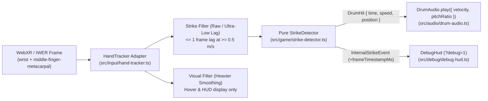

# Phase 1 Implementation Plan (`docs/PHASE1_PLAN.md`) — Hands-Only Strike Detection & Drum Sound (M1)

> **Status:** Revised Plan for Review (PR #10 on `docs/phase1-plan` — no code or dependency changes in this PR).

---

## 1. Decisions & Architectural Summary

1. **Original Drum Audio Placeholder (`OfflineAudioContext`):** Approved. `DrumAudio` exposes `play({ velocity, pitchRatio })` in M1 (with `pitchRatio = 1.0` default) so Phase 2 pitch bending requires no API rework. `docs/ASSET_REGISTER.md` marks the procedural _gángan_ sound as an original placeholder to be replaced by Fredrick's studio recording.
2. **Struck Drumhead Orientation:** The player strikes the **top drumhead**, tilted at **`30°` toward the seated player** (`drumTiltDeg: 30` in `src/app/config.ts`).
3. **`?emulate=1` Desktop Judge Mode:** Deferred to **Phase 1.5 (post-M1 optional stretch)** with an honest effort estimate of **`5.0 – 6.0 hours`** (custom mouse-driven virtual hand interaction).
4. **Startup Loading Banner:** Approved as an early-feedback banner (`#app-loading-banner`, `role="status"`). It does **not** shorten the actual `~3 s` Three.js/IWSDK boot time (the `3.35 s` M0 LCP element was the `?debug=1` HUD); its success criteria are: visible at first paint, removed when `World.create()` resolves, displays a plain error message if startup fails, and produces zero console errors.



---

## 2. Subsystem Design

### 2.1 Task 0 Spike (First Task of M1): Verify Zero Third-Party Mesh Fetches in XR

- **Why This Runs First:** `@iwsdk/xr-input` includes `XRHandVisualAdapter` and `XRControllerVisualAdapter`, which may attempt to load hand or controller glTF profiles from an external CDN when an `XRInputSource` connects during an active XR session.
- **Spike Procedure:**
  1. Add `iwer` as an explicit `devDependency` in `package.json` and run an automated Playwright test that starts an emulated `immersive-vr` session with virtual hands connected while recording all network requests.
  2. Confirm whether any request leaves the application's origin.
  3. **If any third-party fetch occurs:** Override the hand/controller visual loader (or bundle the minimal asset locally under `public/`) **before starting any other M1 task**, so the XR-session Playwright e2e test enforces **zero third-party requests** both outside and inside an active WebXR session.

### 2.2 `HandTracker` Adapter (`src/input/hand-tracker.ts`) & Dual-Path `OneEuroFilter3D` (`src/input/one-euro-filter.ts`)

- **Strike Point Selection (Palm Default, Fingertip Option):**
  - Default strike point (`strikePointMode: 'palm'` in `src/app/config.ts`) is the **palm midpoint** computed from the WebXR `XRHand` `wrist` and `middle-finger-metacarpal` joint poses:
    $$\mathbf{p}_{\text{palm}} = \frac{1}{2}\left(\mathbf{p}_{\text{wrist}} + \mathbf{p}_{\text{middle-finger-metacarpal}}\right)$$
  - Configurable fallback option: `strikePointMode: 'index-finger-tip'` (uses the `index-finger-tip` joint). Final choice between `'palm'` and `'index-finger-tip'` will be confirmed after testing on a physical Meta Quest headset.
- **Single-Hand Enforcement (`allowSecondaryHand: false`):**
  - `primaryHand` defaults to `'right'` (configurable to `'left'` in `src/app/config.ts` or via `?hand=left`).
  - `allowSecondaryHand` defaults to **`false`** because the non-striking hand (left hand by default) is **reserved for under-arm tension cord pitch-squeeze in Phase 2**, preventing accidental drumhead strikes from the squeezing hand.
- **Confidence & Emulation Gating:**
  - Validates that `inputSource.hand` is present and `frame.getJointPose(jointSpace, refSpace)` returns finite coordinates.
  - Distinguishes hardware-tracked poses (`jointPose.emulatedPosition === false`) from emulated poses (`jointPose.emulatedPosition === true`), controlled by `allowEmulatedPoses: true` in `src/app/config.ts` and surfaced in `DebugHud` (`TRACKED` vs. `EMULATED`).
- **Dual-Path Filtering (Fixing Strike Lag):**
  - Using `minCutoffHz = 1.5 Hz` with `beta = 0.04` on velocities in `m/s` would keep $f_c \approx 1.52\text{ Hz}$ ($\tau \approx 105\text{ ms}$) during a `0.5 m/s` strike, adding `~100 ms` of lag.
  - Instead, `HandTracker` separates **strike detection** from **visual/hover smoothing**, with all parameters and units explicitly declared in `src/app/config.ts`:
    - **`strikeFilter` (feeds `StrikeDetector`):** Raw or ultra-light filtering (`enabled: true`, `minCutoffHz: 28.0` $\text{Hz}$, `beta: 18.0` $\text{Hz}/(\text{m/s})$, `dCutoffHz: 35.0` $\text{Hz}$, `maxGapMs: 100` $\text{ms}$). At $v = 0.5\text{ m/s}$, $f_c = 28 + 18(0.5) = 37\text{ Hz}$ ($\tau \approx 4.3\text{ ms}$), keeping effective tracking lag well below **one frame at 72 Hz (`13.89 ms`)**. Can also be bypassed (`enabled: false`) for zero-lag raw joint poses.
    - **`visualFilter` (feeds hover indicators & HUD distance readout only):** Heavier smoothing (`minCutoffHz: 2.0` $\text{Hz}$, `beta: 1.5` $\text{Hz}/(\text{m/s})$, `dCutoffHz: 5.0` $\text{Hz}$, `maxGapMs: 100` $\text{ms}$) to eliminate stationary hand jitter in visual readouts.
  - **Unit Test Gate:** `tests/unit/one-euro-filter.test.ts` includes a mandatory assertion that fails if `strikeFilter` effective lag at speeds $\ge 0.5\text{ m/s}$ (sampled at `72 Hz`) exceeds one frame (`13.89 ms`).

### 2.3 Pure `StrikeDetector` (`src/game/strike-detector.ts`)

- **Pure Functional Signature:**
  - `detectStrike(prevSample, currSample, handState, config)` operates purely on drum-local coordinates and timestamps with zero Three.js or WebXR state.
- **Coordinate Frame & Swept Segment-vs-Skin-Plane Test:**
  - `StrikeSystem` transforms the strike point into **drum-local coordinates** (`drumObject.worldToLocal(...)`), where the **top drumhead** (tilted `30°` toward the seated player in world space via `drumTiltDeg: 30`) lies on the plane $y = +L/2$ (`+0.19 m`) with outward normal $+Y$.
  - **Crossing & Intersection:**
    1. Tests whether signed height above the top skin plane $d = y - L/2$ crossed from $d_{t-1} > 0$ to $d_t \le 0$ over $\Delta t = t - t_{t-1} > 0$.
    2. Computes crossing fraction $u = \frac{d_{t-1}}{d_{t-1} - d_t} \in [0, 1]$ and plane intersection point $\mathbf{p}_{\text{hit}} = \mathbf{p}_{t-1} + u(\mathbf{p}_t - \mathbf{p}_{t-1})$.
    3. **Hit Radius Gate:** Requires radial distance $r = \sqrt{p_{\text{hit},x}^2 + p_{\text{hit},z}^2} \le \text{headRadiusMeters} + \text{hitRadiusMarginMeters}$ (`0.11 m + 0.01 m = 0.12 m`).
    4. **Minimum Downward Speed Gate (`minDownwardSpeedMetersPerSec`):** Computes downward normal speed $v_{\text{down}} = \frac{d_{t-1} - d_t}{\Delta t}$ and requires $v_{\text{down}} \ge \text{minDownwardSpeedMetersPerSec}$ (starting at **`0.30 m/s`**).
    5. **Per-Hand Debounce & Re-Arm:** Requires `time - lastHitTimeMs >= debounceMs` (starting at **`90 ms`**) and requires the hand to rise back above `rearmDistanceMeters: 0.008` (`8 mm`) before re-triggering.
- **Payloads (`DrumHit` vs. `InternalStrikeEvent`):**
  - **Public `DrumHit` payload** (kept strictly as specified):
    ```ts
    export interface DrumHit {
      readonly time: number; // Hit timestamp in ms
      readonly speed: number; // Downward strike speed in m/s
      readonly position: { readonly x: number; readonly y: number; readonly z: number }; // Drum-local hit position (m)
    }
    ```
  - **Internal `InternalStrikeEvent` wrapper** (used by `StrikeSystem` for HUD telemetry):
    ```ts
    export interface InternalStrikeEvent {
      readonly hit: DrumHit;
      readonly hand: 'left' | 'right';
      readonly frameTimestampMs: number; // performance.now() at XR frame entry for software pipeline latency
    }
    ```
- **Centralised Tunables in `src/app/config.ts` (Single Consistent Names):**
  - `drumPlacement.distanceAheadMeters`: `0.50` (must never exceed `0.61 m` / `2 ft` contest reach limit)
  - `drumPlacement.belowEyeLevelMeters`: `0.35`
  - `drumPlacement.drumTiltDeg`: `30` (top drumhead tilted `30°` toward the seated player)
  - `strike.minDownwardSpeedMetersPerSec`: `0.30` (m/s)
  - `strike.debounceMs`: `90` (ms)
  - `strike.hitRadiusMarginMeters`: `0.01` (m; effective hit radius `0.12 m`)
  - `strike.rearmDistanceMeters`: `0.008` (m)
  - `strike.primaryHand`: `'right'` (`'left' | 'right'`)
  - `strike.allowSecondaryHand`: `false`
  - `strike.strikePointMode`: `'palm'` (`'palm' | 'index-finger-tip'`)

### 2.4 Drum Sound Engine (`src/audio/drum-audio.ts`)

- **Single `AudioContext` & Pre-Decoded Buffer:**
  - Creates one `AudioContext` (`{ latencyHint: 'interactive' }`), resumed on the first user gesture (`Enter VR` click, spatial button click, or `selectstart`).
  - Synthesizes a deterministic `0.65 s` Yoruba _gángan_ placeholder `AudioBuffer` at startup via `OfflineAudioContext` (and supports `decodeAudioData` for swapping in Fredrick's studio recording).
  - Documented in `docs/ASSET_REGISTER.md` as an original MIT-licensed placeholder (`"Placeholder — to be replaced by Fredrick's original recording"`).
- **Phase-2-Ready Playback Signature:**
  ```ts
  play(params: { velocity: number; pitchRatio?: number }): void
  ```
  - `velocity`: downward speed in `m/s` mapped via perceptual gain curve $g(v) = g_{\min} + (1 - g_{\min}) \cdot \text{clamp}\left(\frac{v - v_{\min}}{v_{\max} - v_{\min}}, 0, 1\right)^{0.75}$.
  - `pitchRatio`: defaults to `1.0` in Phase 1; sets `sourceNode.playbackRate.value = pitchRatio` so Phase 2 tension-cord pitch bending requires zero changes to `DrumAudio.play()`.
  - Routes `AudioBufferSourceNode -> GainNode -> PannerNode (at drum world position) -> destination`.
  - Increments a diagnostic counter `voicesStartedCount` on each scheduled `sourceNode.start(0)` for deterministic e2e test assertions.

### 2.5 Latency Probe in `DebugHud` (`src/debug/debug-hud.ts`)

- Removes any unverifiable `"< 35 ms motion-to-ear"` claim.
- Displays two clearly labeled metrics in `?debug=1`:
  1. **`software pipeline: X.XX ms`** — `performance.now() - internalEvent.frameTimestampMs` (elapsed time from XR frame callback start through `HandTracker`, `strikeFilter`, and `StrikeDetector` to `sourceNode.start(0)`).
  2. **`audio buffer estimate (not tracking latency): base X.X ms | out X.X ms (or n/a)`** — reads `audioCtx.baseLatency` (in ms, or `"n/a"` if undefined) and `audioCtx.outputLatency` (in ms, explicitly rendered as **`"n/a"`** when `audioCtx.outputLatency === undefined`).

### 2.6 Reach Constraint ($\le 0.61\text{ m}$), Layout Follow-Ups & Startup Loading Banner

- **2 ft (`0.61 m`) Reach Rule:**
  - The drum stays at **`distanceAheadMeters: 0.50`** (`0.50 m < 0.61 m`). We do **not** push the drum farther away.
  - To fix the M0 lower-edge cropping and welcome-panel crowding:
    1. Tilt the drum `30°` toward the player (`drumTiltDeg: 30`) and adjust the flat desktop camera `lookAt` / `position` in `iwsdk.config.json` and `public/scenes/main.iwsdk.scene.json` (`camera.position: [0, 1.6, 0.45]`, `camera.lookAt: [0, 1.22, -0.50]`).
    2. Raise `welcome-panel` in `public/scenes/main.iwsdk.scene.json` (`y: 1.68, z: -1.42`) so it sits cleanly above the top of the drum.
  - **On-Device Reach & Eye-Level Note:** Both seated eye-level calibration and comfortable right-hand strike reach at `0.50 m` must be verified on a physical Meta Quest headset.
- **Startup Loading Banner (`index.html` + `src/index.ts`):**
  - Inline HTML/CSS `#app-loading-banner` (`role="status"`, `aria-live="polite"`) visible immediately at first paint (`"Loading Talking Drum VR..."`).
  - Removed (`banner.hidden = true`) as soon as `World.create(...)` resolves.
  - If `World.create(...)` rejects, `#app-loading-banner` stays visible, switches to error styling, and displays `"Could not start Talking Drum VR. Please reload the page."` with zero unhandled promise rejections.

---

## 3. Testing Strategy & Emulator Hand-Tracking Note

### 3.1 Unit Tests (`npm run test:unit`)

- **Synthetic Hand-Path Fixtures (`tests/fixtures/hand-paths.ts`):**
  - _Note:_ All fixture trajectories in `tests/fixtures/hand-paths.ts` are **synthetic** mathematical paths until a physical Meta Quest session records real optical hand-tracking trajectories.
  - Covers: (1) clean downward strike at `0.85 m/s` within `0.12 m` radius $\rightarrow$ 1 `DrumHit`; (2) slow hover at `0.18 m/s` (`< 0.30 m/s`) $\rightarrow$ `null`; (3) double-bounce `40 ms` apart (`< 90 ms` debounce) $\rightarrow$ 1 `DrumHit`; (4) off-rim miss at `r = 0.14 m` (`> 0.12 m`) $\rightarrow$ `null`; (5) upward return stroke $\rightarrow$ `null`.
- **`tests/unit/one-euro-filter.test.ts`:**
  - Tests `OneEuroFilter3D` smoothing at rest, dropout reset after `> 100 ms`, and enforces that `strikeFilter` lag at $\ge 0.5\text{ m/s}$ (at `72 Hz`) is $\le 13.89\text{ ms}$ (one frame).
- **`tests/unit/strike-detector.test.ts`:**
  - Tests `detectStrike` across all synthetic fixtures, `allowSecondaryHand: false` gating, and config overrides.

### 3.2 Playwright E2E with Injected IWER (`npm run test:e2e`)

- **Explicit `iwer` DevDependency:** Add `"iwer": "^2.6.0"` to `devDependencies` in `package.json` so CI does not rely on transitive hoisting.
- **End-to-End XR Hand Strike Test (`tests/e2e/smoke.spec.ts`):**
  1. Uses `page.addInitScript` to load `iwer` (`XRDevice` with `metaQuest3` config and `primaryInputMode = 'hand'`) in headless Chromium.
  2. Clicks **Enter VR** to start a real WebXR session and unlock `AudioContext`.
  3. Drives the virtual right hand (`wrist` and `middle-finger-metacarpal` joints) downward across the tilted top drumhead at `> 0.30 m/s`.
  4. Asserts via diagnostic state/HUD that:
     - `audioContextState === 'running'` and `voicesStartedCount >= 1` (proving the full `HandTracker -> StrikeDetector -> DrumAudio.play()` pipeline executed; CI asserts counters/state, not audible sound).
     - `DebugHud` displays the updated strike counter, `software pipeline` latency, and `audio buffer estimate (not tracking latency)`.
     - **Zero console errors, zero failed requests, and zero third-party network requests** occurred during the active XR session.

### 3.3 What CI Can and Cannot Prove Without a Headset

| Verification Target                                                             | Provable in CI (Vitest / Playwright + IWER)? | Requires Physical Meta Quest? |
| ------------------------------------------------------------------------------- | -------------------------------------------- | ----------------------------- |
| `StrikeDetector` math, `0.30 m/s` speed gate, `0.12 m` radius, `90 ms` debounce | **Yes** (Vitest synthetic fixtures)          | No                            |
| `strikeFilter` lag $\le 1$ frame (`13.89 ms`) at $\ge 0.5\text{ m/s}$           | **Yes** (Vitest unit test)                   | No                            |
| Full `HandTracker -> StrikeDetector -> DrumAudio.play()` pipeline + counters    | **Yes** (Playwright + injected `iwer`)       | No                            |
| Zero third-party network requests before and during an active XR session        | **Yes** (Playwright network listener)        | No                            |
| Audible acoustic quality, physical speaker output & real hardware latency       | **No** (CI checks `voicesStartedCount`)      | **Yes**                       |
| Real optical hand-tracking confidence dropouts, palm vs. fingertip ergonomics   | **No** (CI uses synthetic hand paths)        | **Yes**                       |
| Seated eye-level calibration & comfortable `0.50 m` strike reach                | **No**                                       | **Yes**                       |

### 3.4 Switching Immersive Web Emulator (v2.0.0) to Hand Tracking — **UNVERIFIED**

> [!WARNING]
> **UNVERIFIED UI STEPS:** In M0, Fredrick observed that the **Immersive Web Emulator Chrome extension (`v2.0.0`)** renders an **on-page toolbar** when active, not a Chrome DevTools tab, and no official documentation confirms the exact v2.0.0 control labels for switching from controllers to hand tracking.
>
> Rather than guessing UI steps, we will inspect the live on-page IWER v2.0.0 toolbar during M1 implementation, verify how it toggles between Controllers and Hands, and replace this section with verified step-by-step instructions. (Meanwhile, automated CI tests will switch `device.primaryInputMode = 'hand'` programmatically via the `iwer` API).

---

## 4. Investigation: Lazy-Loading Desktop Emulation (`?emulate=1`) — Deferred to Phase 1.5

- **Feasibility with IWSDK `1.0.1`:** Compatible via a conditional dynamic `await import('./platform/desktop-emulator.js')` in `src/index.ts` before `World.create()`.
- **Bundle Size Impact:**
  - `iwer@2.6.0` minified ES module (`node_modules/iwer/build/iwer.module.min.js`) is **`263,136 B` (`263.1 kB` raw / `~75 kB` gzipped)**.
  - Because it is loaded only via dynamic `import()` when `?emulate=1` is present, **initial-load JS impact is `0 B` (`0.000 MB`)**, and total `dist/` increases by `~0.26 MB` (or `~1.14 MB` if `@iwer/devui` is included), well within the `25.00 MB` limit.
- **Licences:** `iwer@2.6.0`, `gl-matrix@3.4.4`, `webxr-layers-polyfill@1.1.0`, and `@iwer/devui@2.6.0` are all **MIT**.
- **Risks:**
  1. `@iwsdk/xr-input` third-party mesh fetches (addressed in M1 Task 0 Spike).
  2. Overwriting a real WebXR runtime if `?emulate=1` is opened on a Quest headset (mitigated by checking `isSessionSupported('immersive-vr')` first).
  3. Designing a mouse/keyboard-driven virtual hand that feels natural for judges without a headset requires custom pointer-to-hand-joint mapping and UI affordances.
- **Honest Effort Estimate:** **`5.0 – 6.0 hours`** (1.5 h lazy `iwer` runtime bootstrap + guardrails, 2.5–3.0 h custom mouse-to-virtual-hand strike controller & visual feedback, 1.0–1.5 h Playwright e2e + cross-browser verification).
- **Decision:** **Deferred to Phase 1.5 (post-M1 optional stretch).** Not part of core M1.

---

## 5. Milestone M1 Definition of Done, File List, Risks & Effort

### 5.1 M1 Definition of Done (DoD)

1. **Task 0 Spike Complete:** Confirmed (and if needed, patched) that starting an XR session with hands/controllers makes **zero third-party network requests**.
2. **Strike Pipeline & Audio Counter Verified:** In Playwright e2e (with injected `iwer` scripted hands) and in the emulator, striking the `30°`-tilted top drumhead at $\ge 0.30\text{ m/s}$ triggers `DrumAudio.play({ velocity, pitchRatio: 1.0 })`, transitions `AudioContext` to `'running'`, and increments `voicesStartedCount` with zero console errors.
3. **Lag & Latency Probe Verified:**
   - `strikeFilter` unit test proves lag $\le 1$ frame at `72 Hz` (`13.89 ms`) for speeds $\ge 0.5\text{ m/s}$.
   - `?debug=1` HUD shows `software pipeline` latency and `audio buffer estimate (not tracking latency)` (with `outputLatency` shown as `"n/a"` when undefined).
4. **Startup Banner & Reach-Safe Framing:**
   - `#app-loading-banner` is visible at first paint, removed when `World.create()` resolves, and shows a plain error message if startup fails.
   - Drum remains at `0.50 m` ahead ($\le 0.61\text{ m}$ contest limit); cropping and panel overlap are resolved via `30°` drum tilt, welcome-panel elevation, and desktop camera framing.
5. **All Gates Green:** `lint`, `format:check`, `typecheck`, `test:unit`, `content:validate`, `build`, `budget:check`, and `test:e2e` / `test:e2e:live` pass in CI and on live GitHub Pages.

### 5.2 Expected M1 File List (Create / Modify)

| File Path                             | Action     | Responsibility                                                                                                        |
| ------------------------------------- | ---------- | --------------------------------------------------------------------------------------------------------------------- |
| `package.json` & `package-lock.json`  | **Modify** | Add `"iwer": "^2.6.0"` explicitly under `devDependencies` for XR e2e testing                                          |
| `src/app/config.ts`                   | **Modify** | Add `drumTiltDeg: 30`, `strike` (`minDownwardSpeedMetersPerSec`, `allowSecondaryHand: false`), filter & audio configs |
| `src/app/flags.ts`                    | **Modify** | Parse optional `?hand=left\|right`                                                                                    |
| `src/input/one-euro-filter.ts`        | **Create** | Pure 3D One Euro filter (`strikeFilter` + `visualFilter` configs with explicit units)                                 |
| `src/input/hand-tracker.ts`           | **Create** | Reads `wrist` + `middle-finger-metacarpal` palm midpoint (or `index-finger-tip`), gates confidence/hand               |
| `src/game/strike-detector.ts`         | **Create** | Pure swept segment-vs-skin-plane test emitting `DrumHit { time, speed, position }`                                    |
| `src/audio/drum-audio.ts`             | **Create** | Single `AudioContext`, `OfflineAudioContext` _gángan_ placeholder, `play({ velocity, pitchRatio })`, counters         |
| `src/game/strike-system.ts`           | **Create** | ECS system wiring `HandTracker -> StrikeDetector -> DrumAudio` + `InternalStrikeEvent` HUD telemetry                  |
| `src/debug/debug-hud.ts`              | **Modify** | Display hand state, strike count/speed, `software pipeline`, and `audio buffer estimate (not tracking latency)`       |
| `src/index.ts`                        | **Modify** | Register `StrikeSystem`; hide `#app-loading-banner` on resolve or show plain error message on failure                 |
| `index.html`                          | **Modify** | Add `#app-loading-banner` (`role="status"`) visible at first paint                                                    |
| `iwsdk.config.json`                   | **Modify** | Adjust flat desktop camera `position` / `lookAt` so `0.50 m` tilted drum is uncropped                                 |
| `public/scenes/main.iwsdk.scene.json` | **Modify** | Apply `30°` X-tilt to `talking-drum` at `z: -0.50`, raise `welcome-panel`, sync hero camera                           |
| `docs/ASSET_REGISTER.md`              | **Modify** | Record procedural _gángan_ placeholder (to be replaced by Fredrick's recording)                                       |
| `docs/TEST_PLAN.md`                   | **Modify** | Record M1 test results and verified IWER v2.0.0 hand-tracking steps                                                   |
| `tests/fixtures/hand-paths.ts`        | **Create** | Synthetic 72 Hz hand strike, hover, bounce, and miss paths                                                            |
| `tests/unit/one-euro-filter.test.ts`  | **Create** | Unit tests including $\le 13.89\text{ ms}$ lag assertion at $\ge 0.5\text{ m/s}$                                      |
| `tests/unit/strike-detector.test.ts`  | **Create** | Unit tests for `StrikeDetector` and `allowSecondaryHand: false`                                                       |
| `tests/e2e/smoke.spec.ts`             | **Modify** | Verify loading banner lifecycle + injected-IWER XR hand strike (`voicesStartedCount`, zero 3rd-party requests)        |

### 5.3 Risks & Mitigations

| Risk                                                                                 | Impact | Mitigation                                                                                                     |
| ------------------------------------------------------------------------------------ | ------ | -------------------------------------------------------------------------------------------------------------- |
| `@iwsdk/xr-input` fetches hand/controller glTF profiles from a third-party CDN in XR | High   | **Task 0 Spike** runs first in M1; intercept/override loader before any other M1 work                          |
| Heavy low-pass filter delays strike detection by `~100 ms`                           | High   | Separate `strikeFilter` ($\le 1$ frame lag at $\ge 0.5\text{ m/s}$, enforced by unit test) from `visualFilter` |
| Moving drum farther than `0.50 m` violates `2 ft` (`0.61 m`) reach rule              | High   | Keep `distanceAheadMeters: 0.50`; fix cropping via `30°` drum tilt and flat desktop camera framing             |
| `audioCtx.outputLatency` is `undefined` in headless Chromium or Quest Browser        | Low    | Format `undefined` explicitly as `"n/a"` in `DebugHud`                                                         |

### 5.4 Effort Estimate (Core M1 vs. Deferred Phase 1.5)

| Task                                                                                             | Estimated Effort |
| ------------------------------------------------------------------------------------------------ | ---------------- |
| **0. Spike:** Verify `@iwsdk/xr-input` XR session network requests & patch any 3rd-party fetch   | `1.5 h`          |
| **1.** Dual-path `OneEuroFilter3D` + `HandTracker` (palm midpoint default) + lag unit test       | `2.0 h`          |
| **2.** Pure `StrikeDetector` + synthetic `tests/fixtures/hand-paths.ts` + unit tests             | `2.0 h`          |
| **3.** `DrumAudio.play({ velocity, pitchRatio })` + `OfflineAudioContext` placeholder + counters | `2.0 h`          |
| **4.** `StrikeSystem` + `DebugHud` latency probe + startup banner + `30°` tilt / camera framing  | `2.0 h`          |
| **5.** Playwright e2e test with injected `iwer` (`addInitScript`) + live smoke verification      | `2.0 h`          |
| **Total Core Phase 1 (M1) Effort**                                                               | **`11.5 hours`** |
| _(Deferred Phase 1.5 Optional Stretch)_ `?emulate=1` desktop judge mode with mouse-driven hand   | `5.0 – 6.0 h`    |
